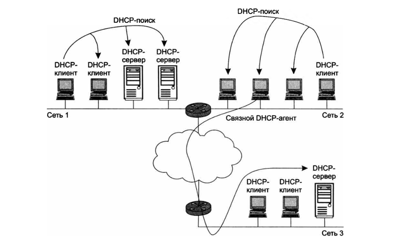

## 1. Что такое DHCP и зачем он нужен

**DHCP (Dynamic Host Configuration Protocol)** - протокол динамического конфигурирования хостов. Он автоматически выдаёт компьютерам и маршрутизаторам IP-адреса и другие сетевые настройки.

**Проблема, которую он решает:**
- Каждому устройству в сети нужен IP-адрес.
- Настраивать вручную долго и муторно.
- Администратор должен помнить, какие адреса заняты, а какие свободны.
- Кроме IP-адреса, нужно выдать ещё кучу параметров: маску, адрес шлюза, DNS-сервер, доменное имя и т.д.

**Решение:** DHCP делает всё это автоматически и централизованно. Дублирование адресов исключено - распределением управляет сервер.

---

## 2. Предшественники DHCP

### 2.1 RARP (Reverse Address Resolution Protocol)

Появился более 30 лет назад. Первая попытка автоматической выдачи IP.

**Как работал:**
1. Клиент отправлял широковещательный запрос в сеть.
2. Сервер принимал его, находил в своей базе привязку MAC-адреса клиента к IP.
3. Отправлял клиенту его IP-адрес.

**Минусы:**
- Сервер нужно было настраивать в каждом сегменте сети.
- Нужно вручную регистрировать MAC-адреса.
- Нельзя передать клиенту дополнительную информацию.

### 2.2 BOOTP (Bootstrap Protocol)

Пришёл на смену RARP. Изначально - для бездисковых рабочих станций.

**Что умел:**
- Выдавать IP-адрес.
- Передавать дополнительную информацию: адрес TFTP-сервера, имя файла загрузки.
- Поддерживал **relay** - сервисы-посредники, которые пересылали запросы «главному» серверу.

**Плюс:** один сервер мог обслуживать несколько сетей.

**Минусы:**
- Таблицы всё ещё нужно было настраивать вручную.
- Ограничение по размеру дополнительной информации.

### 2.3 DHCP

Современный протокол. **Является совместимым расширением BOOTP.**
- DHCP-сервер поддерживает старых клиентов BOOTP.
- Наоборот - не работает.

---

## 3. Режимы работы DHCP

DHCP работает по модели **клиент-сервер**.

**Как это выглядит:**
1. Компьютер включается и отправляет широковещательный запрос на получение IP.
2. DHCP-сервер отвечает и присылает IP + другие параметры.

**Три режима работы сервера:**

### 3.1 Ручное назначение статических адресов

Администратор сам прописывает: «вот этому MAC-адресу - вот этот IP».

- Сервер всегда выдаёт клиенту один и тот же адрес.
- Плюс - полный контроль.
- Минус - ручная работа.

### 3.2 Автоматическое назначение статических адресов

Сервер сам выбирает клиенту IP из пула при первом обращении.

- Адрес даётся **навсегда** (постоянное соответствие клиент ↔ IP).
- При следующих запросах сервер возвращает тот же адрес.

### 3.3 Динамическое распределение адресов

Сервер выдаёт адрес **на время** - это называется **срок аренды**.

- Ушёл из подсети - адрес освободился.
- Подключился к другой - получил новый.
- Ни пользователь, ни админ не вмешиваются.

**Главный плюс:** можно строить сеть, где узлов **больше**, чем IP-адресов.

**Пример из презентации:**
- В организации 500 сотрудников, но большинство работает вне офиса.
- Одновременно в офисе бывает не больше 50 человек.
- Вместо 500 адресов (две сети класса C) достаточно **64 адресов** и 64 рабочих мест.
- Каждый приходящий сотрудник автоматически получает свободный IP.

---

## 4. Алгоритм динамического назначения адресов

### 4.1 Что настраивает администратор

Два главных параметра DHCP-сервера:
1. **Пул адресов** - какие IP можно раздавать.
2. **Срок аренды** - как долго клиент может использовать адрес.

**Срок аренды зависит от ситуации:**
- Учебная аудитория - на время лабораторной работы.
- Корпоративная сеть - несколько дней или недель.

### 4.2 Где стоит DHCP-сервер

Обычно DHCP-сервер находится **в одной подсети с клиентами**, потому что клиенты шлют **широковещательные** запросы.

**Резервный сервер.** Если основной сервер упадёт, сеть останется без адресов. Поэтому иногда ставят второй DHCP-сервер.

### 4.3 Связной DHCP-агент (relay agent)

Если DHCP-сервера в сети нет, его роль выполняет **связной агент**.
- Это программа-посредник между клиентами и сервером.
- Пересылает запросы клиентов серверу в другой сети.
- Один DHCP-сервер может обслуживать **несколько сетей** через агентов.

### 4.4 Пошаговый обмен сообщениями

| Шаг | Что происходит |
|---|---|
| **1** | Компьютер включается → DHCP-клиент шлёт **широковещательный DHCP-поиск** (IP-адрес из одних единиц). |
| **2** | DHCP-серверы получают запрос. Если их нет - запрос ловит **relay-агент** и пересылает серверу в другой сети. |
| **3** | Все DHCP-серверы шлют клиенту свои **DHCP-предложения** (IP + параметры). |
| **4** | Клиент выбирает **первое предложение** и шлёт широковещательный **DHCP-запрос** с идентификатором выбранного сервера. |
| **5** | Только выбранный сервер шлёт **положительную DHCP-квитанцию** (подтверждение адреса и аренды). Остальные аннулируют предложения. |
| **6** | Клиент получает квитанцию и переходит в **рабочее состояние**. |

### 4.5 Обновление аренды

- Клиент периодически пытается **обновить параметры** у сервера.
- Первая попытка - задолго до истечения срока.
- Если сервер не отвечает - попытки повторяются.
- Если всё безуспешно - клиент обращается к **другому серверу**.
- Если и тот отказывает - клиент теряет параметры и переходит в **режим автономной работы**.
- Клиент может сам **досрочно отказаться** от параметров.

---

## 5. Проблемы динамических адресов

Динамические IP постоянно меняются - и это создаёт проблемы.

### 5.1 Проблема с DNS

DNS должна хранить таблицы «символьное имя → IP». Если IP меняется каждые два часа - таблицы невозможно поддерживать.

**Решение:** серверам, к которым обращаются по имени, назначают **статические** IP. Динамические оставляют только клиентским компьютерам.

### 5.2 Динамическая DNS (DDNS)

Если серверов много, вручную их настраивать тяжело. Придумали **динамическую DNS** - она согласует базу адресов между DHCP и DNS.

### 5.3 Проблема с удалённым управлением

Трудно управлять устройством и собирать статистику, если его IP постоянно меняется.

**Решение:** статические адреса для устройств, которые предоставляют услуги:
- маршрутизаторы,
- серверы,
- принтеры,
- другие сетевые устройства, чьё местоположение не меняется.

### 5.4 Проблема с безопасностью

Многие устройства фильтруют пакеты по IP-адресам. При динамических адресах фильтрация усложняется.

**Решение:** для интерфейсов, которые участвуют в мониторинге и безопасности, тоже назначают статические адреса.

---

## 6. Итог

| Плюсы DHCP | Минусы динамических адресов |
|---|---|
| Автоматизация настройки | Сложности с DNS |
| Централизованное управление | Сложности с удалённым управлением |
| Нет дублирования адресов | Сложности с фильтрацией по IP |
| Можно иметь больше узлов, чем IP | Решается статическими адресами для серверов |

**Главная идея:** DHCP экономит время администратора и позволяет эффективно использовать ограниченный пул IP-адресов. Но для устройств, которые должны быть всегда доступны по одному адресу (серверы, роутеры, принтеры), лучше использовать статические адреса.

---

## 7. Схема работы DHCP

