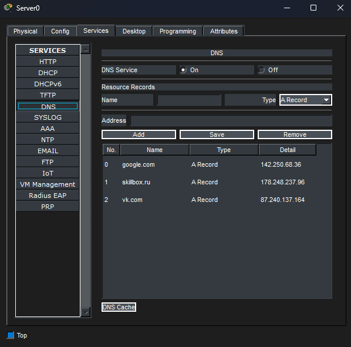
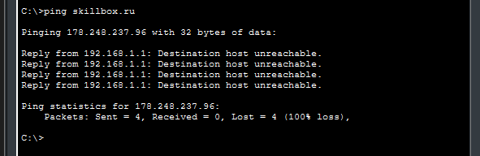
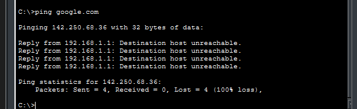
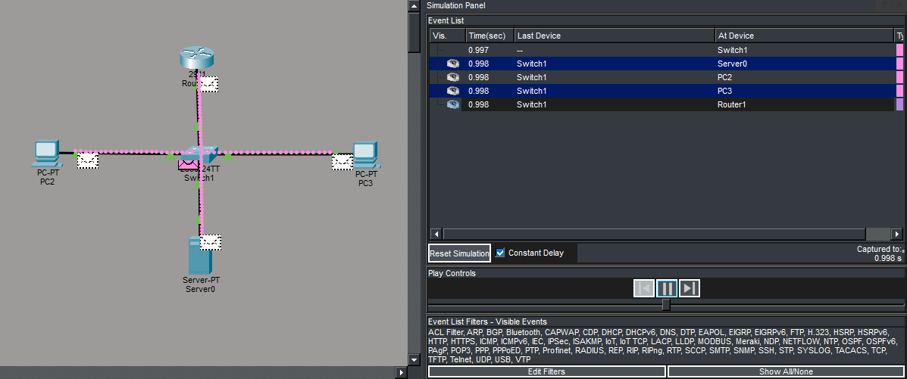

# Отчёт: DNS-сервер на Cisco в Packet Tracer

**Дисциплина:** Компьютерные сети  
**ФИО:** Гаврилов Владислав Михайлович  
**Группа:** РПО/1  
**Дата:** 16.10.2026

## 1. Цель работы

Настроить DNS-сервер в Packet Tracer: `Server-PT` хранит записи типа A для доменов, клиентские PC разрешают имена через этот сервер.

## 2. Оборудование

| Устройство | Модель | Кол-во |
|---|---|---|
| Router | 2911 | 1 |
| Switch | 2960-24TT | 1 |
| Server | Server-PT | 1 |
| PC | PC-PT | 2 |

## 3. Схема сети


**Соединения:**

| От | Порт | До | Порт | Кабель |
|---|---|---|---|---|
| R1 | Gig0/0 | Switch1 | Gig0/1 | Straight-Through |
| Server0 | Fast0 | Switch1 | Fast0/2 | Straight-Through |
| PC2 | Fast0 | Switch1 | Fast0/3 | Straight-Through |
| PC3 | Fast0 | Switch1 | Fast0/4 | Straight-Through |

## 4. Адресация

| Устройство | IP | Маска | Шлюз | DNS |
|---|---|---|---|---|
| R1 (Gi0/0) | 192.168.1.1 | 255.255.255.0 | — | — |
| Server0 | 192.168.1.100 | 255.255.255.0 | 192.168.1.1 | 192.168.1.100 |
| PC2 | 192.168.1.10 | 255.255.255.0 | 192.168.1.1 | 192.168.1.100 |
| PC3 | 192.168.1.11 | 255.255.255.0 | 192.168.1.1 | 192.168.1.100 |

## 5. Настройка сервера

### 5.1 IP-адрес Server0


Server0 → Desktop → IP Configuration:

- IP Address: `192.168.1.100`
- Subnet Mask: `255.255.255.0`
- Default Gateway: `192.168.1.1`
- DNS Server: `192.168.1.100`

### 5.2 DNS-записи



Server0 → Services → DNS → **On**, добавлены записи:

| Name | Type | Address |
|---|---|---|
| skillbox.ru | A Record | 178.248.237.96 |
| vk.com | A Record | 87.240.137.164 |
| google.com | A Record | 142.250.68.36 |

## 6. Настройка PC


PC2 → Desktop → IP Configuration:

- IP Address: `192.168.1.10`
- Subnet Mask: `255.255.255.0`
- Default Gateway: `192.168.1.1`
- DNS Server: `192.168.1.100`

PC3 настроен аналогично с IP `192.168.1.11`.

## 7. Настройка маршрутизатора R1

**R1 → CLI:**

```cisco
enable
configure terminal
hostname R1

interface GigabitEthernet0/0
 ip address 192.168.1.1 255.255.255.0
 no shutdown
exit

end
write memory
```

## 8. Проверка

### 8.1 Доступность сервера


```
ping 192.168.1.100
```

Потери 0 %.

### 8.2 Разрешение имён через DNS



```
ping skillbox.ru
```

Имя разрешилось в `178.248.237.96`. Пакеты уходят на внешний адрес, ответа нет — это нормально для учебного стенда без интернета. Главное — DNS отработал.


```
ping vk.com
```

Имя разрешилось в `87.240.137.164`.



```
ping google.com
```

Имя разрешилось в `142.250.68.36`.

## 9. Simulation Mode



В режиме симуляции видно прохождение DNS-запроса от PC2 к Server0 и обратно. Event List фиксирует все шаги.

## 10. Вывод

DNS-сервер настроен на `Server-PT` с адресом `192.168.1.100`. Записи типа A для `skillbox.ru`, `vk.com`, `google.com` добавлены. Клиенты PC2 и PC3 обращаются к серверу по адресу `192.168.1.100` и успешно разрешают имена в IP-адреса. Цель работы достигнута.