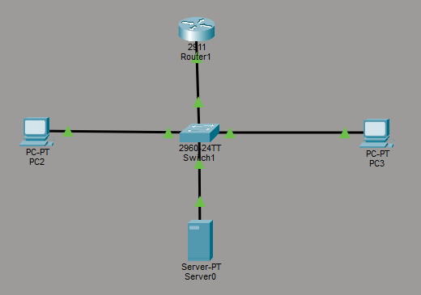
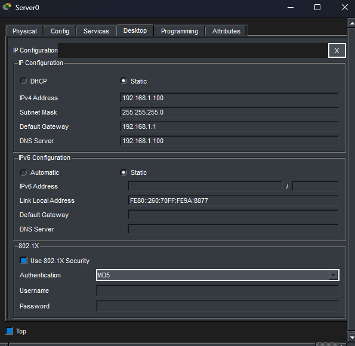
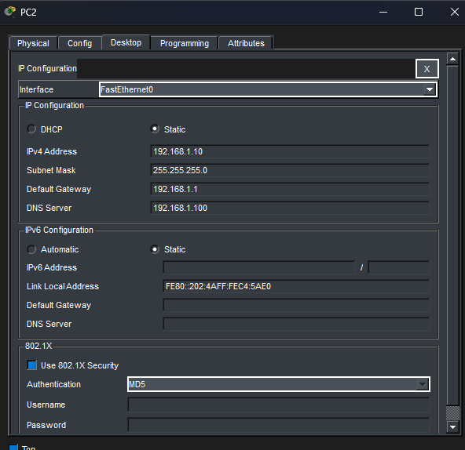
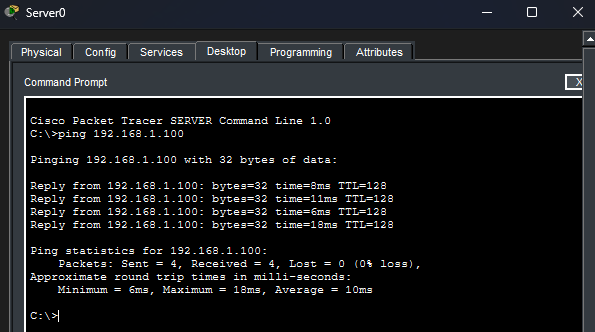
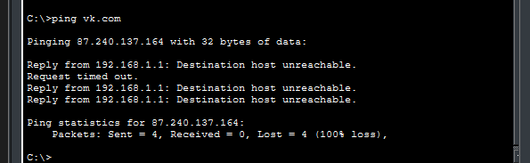

**Схема сети:**

**Адресация:**
*   **R1 (Gi0/0):** `192.168.1.1`
*   **Server0:** `192.168.1.100` (шлюз: `192.168.1.1`, DNS: `192.168.1.100`)
*   **PC2 / PC3:** `192.168.1.10` / `192.168.1.11` (шлюз и DNS аналогичны)

**Настройка:**
1.  **Server0:** Задан IP, во вкладке Services включена служба DNS. 
    
    
    Добавлены A-записи:
    *   `skillbox.ru` — `178.248.237.96`
    *   `vk.com` — `87.240.137.164`
    *   `google.com` — `142.250.68.36`
2.  **PC:** Настроены IP-адреса и указан DNS-сервер (`192.168.1.100`).
    
3.  **R1:** На интерфейсе Gig0/0 задан IP-адрес и применена команда `no shutdown`.

**Проверка:**
*   `ping 192.168.1.100` — успешно (0% потерь).
    
*   `ping skillbox.ru`, `ping vk.com`, `ping google.com` — имена успешно разрешились в IP-адреса (ответа нет — это нормально для изолированного стенда).
    
    
    
*   В режиме симуляции отслежен проход DNS-запроса от PC2 к Server0.
    

**Вывод:** DNS-сервер успешно настроен, клиенты корректно разрешают имена.