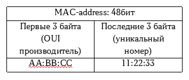
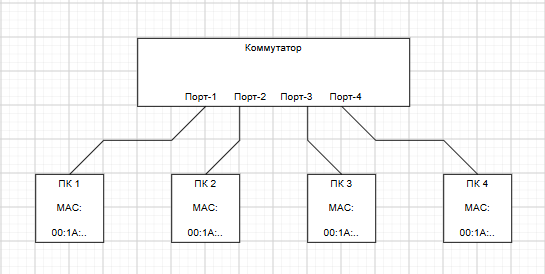
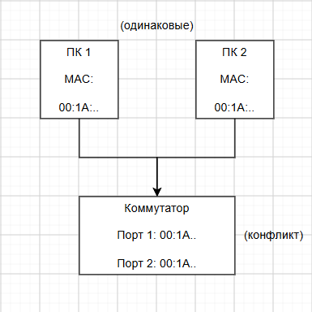

## 1. Схема MAC-адреса
MAC-адрес - это уникальный физический адрес сетевого устройства. Он состоит из 48 бит (6 байт) и записывается в шестнадцатеричном виде.

## Структура:

**Пример:** `00:1A:2B:3C:4D:5E`

| Часть | Значение |
| `00:1A:2B` | Код производителя (OUI) |
| `3C:4D:5E` | Серийный номер устройства |

## Типы адресов

- **Unicast** - адрес одного устройства
- **Multicast** - адрес группы устройств
- **Broadcast** - `FF:FF:FF:FF:FF:FF`

## Схема соединения компьютеров через коммутатор

## Схема

## Как работает коммутатор

1. Коммутатор запоминает MAC-адрес каждого устройства и номер порта, к которому оно подключено.
2. Когда ПК-1 отправляет данные ПК-3, коммутатор смотрит в таблицу и передаёт кадр только на нужный порт.
3. Если адрес неизвестен - рассылает всем, пока не изучит.

## Таблица MAC-адресов коммутатора

| Порт | MAC-адрес | Устройство |
| 1 | 00:1A:2B:3C:4D:5E | ПК-1 |
| 2 | 00:1A:2B:3C:4D:5F | ПК-2 |
| 3 | 00:1A:2B:3C:4D:60 | ПК-3 |
| 4 | 00:1A:2B:3C:4D:61 | ПК-4 |

## Ошибка: конфликт MAC-адресов

Причины:
- администратор вручную прописал одинаковый MAC;
- скопировали виртуальную машину без смены MAC;
- подменили MAC-адрес программой.

## Схема проблемы

## Что происходит

Коммутатор не понимает, на какой порт отправлять данные.
Кадры начинают «прыгать» между портами, связь пропадает или работает нестабильно.
Оба компьютера не могут нормально общаться с сетью.

## Как исправить

1. **Найти конфликт** - посмотреть таблицу MAC-адресов на коммутаторе.
   Если один MAC привязан к двум портам - это ошибка.

2. **Сменить MAC** на одном из устройств:
   - **Windows:** Диспетчер устройств → Сетевая карта → Свойства → Дополнительно → Network Address → ввести новый MAC.
   - **Linux:** `sudo ip link set dev eth0 address 00:1A:2B:3C:4D:99`
   - **Виртуальная машина:** в настройках сети сгенерировать новый MAC.

3. **Проверить** - после смены MAC таблица коммутатора обновится, конфликт исчезнет.

## Профилактика

- не назначать MAC вручную без необходимости;
- при клонировании виртуальных машин всегда менять MAC;
- использовать DHCP и статические привязки IP-MAC на коммутаторе.