# Настройка NAT в Cisco Packet Tracer

## Общая схема сети

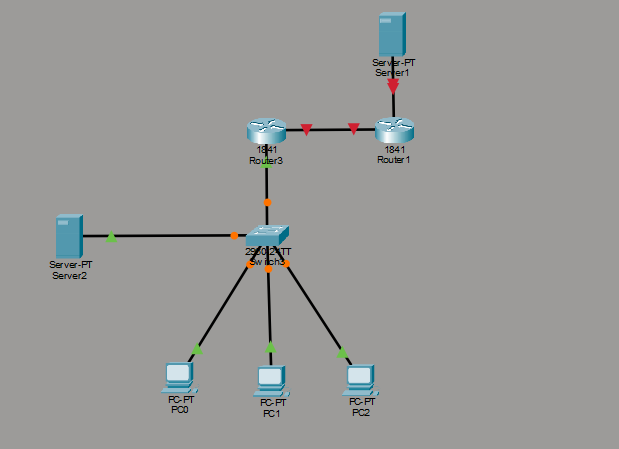

---

## Что настраиваем

- Локальная сеть офиса: 3 компьютера + сервер + коммутатор 2960 + маршрутизатор 1841.
- Провайдер: маршрутизатор 1841 + сервер с белым IP.
- Задача: дать локальным компьютерам доступ в Интернет через **NAT (PAT)** и открыть **статический NAT** для локального веб-сервера.

---

## Соединения портов

| От | Порт | К | Порт |
|---|---|---|---|
| PC0 | Fa0 | Switch0 | Fa0/1 |
| PC1 | Fa0 | Switch0 | Fa0/2 |
| PC2 | Fa0 | Switch0 | Fa0/3 |
| Server0 | Fa0 | Switch0 | Fa0/4 |
| Switch0 | Fa0/5 | Router0 | Fa0/0 |
| Router0 | Fa0/1 | Router1 | Fa0/0 |
| Router1 | Fa0/1 | Server1 | Fa0 |

---

## 1. Switch0 — настройка VLAN и trunk

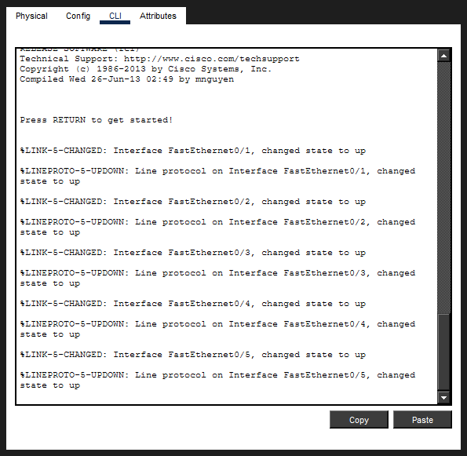
```
enable
configure terminal

vlan 2
name users
exit

vlan 3
name server
exit

interface range Fa0/1-3
switchport mode access
switchport access vlan 2
exit

interface Fa0/4
switchport mode access
switchport access vlan 3
exit

interface Fa0/5
switchport mode trunk
switchport trunk allowed vlan 2,3
end

write memory
```

---

## 2. Router0 — настройка интерфейсов и саб-интерфейсов

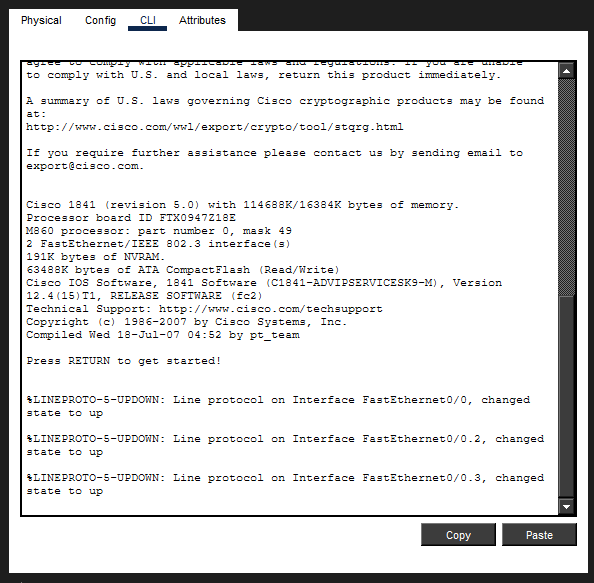
```
enable
configure terminal

interface Fa0/0
no shutdown
exit

interface Fa0/0.2
encapsulation dot1Q 2
ip address 192.168.2.1 255.255.255.0
no shutdown
exit

interface Fa0/0.3
encapsulation dot1Q 3
ip address 192.168.3.1 255.255.255.0
no shutdown
exit

interface Fa0/1
ip address 213.234.10.2 255.255.255.252
no shutdown
exit

ip route 0.0.0.0 0.0.0.0 213.234.10.1
end
write memory
```

---

## 3. Router1 — маршрутизатор провайдера

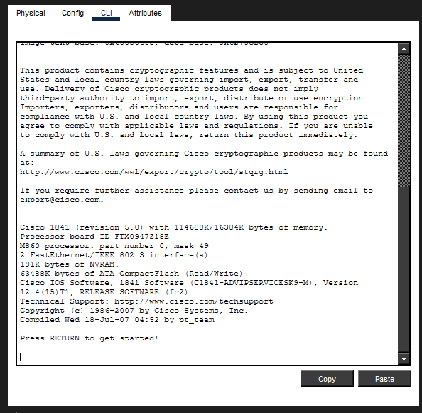
```
enable
configure terminal

interface Fa0/0
ip address 213.234.10.1 255.255.255.252
no shutdown
exit

interface Fa0/1
ip address 213.234.20.1 255.255.255.252
no shutdown
end

write memory
```

---

## 4. Настройка IP на компьютерах

### PC0

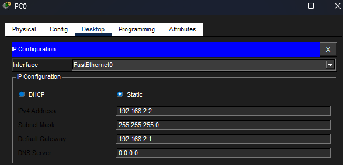
```
IP Address: 192.168.2.2
Subnet Mask: 255.255.255.0
Default Gateway: 192.168.2.1
```

### PC1

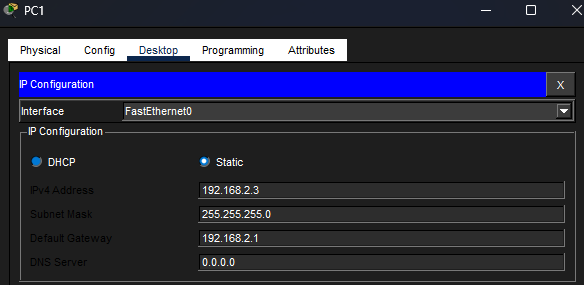
```
IP Address: 192.168.2.3
Subnet Mask: 255.255.255.0
Default Gateway: 192.168.2.1
```

### PC2

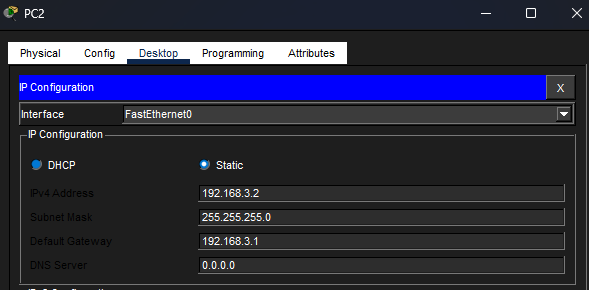
```
IP Address: 192.168.2.4
Subnet Mask: 255.255.255.0
Default Gateway: 192.168.2.1
```

### Server0

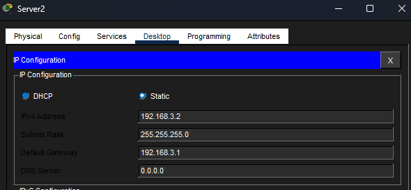
```
IP Address: 192.168.3.2
Subnet Mask: 255.255.255.0
Default Gateway: 192.168.3.1
```

### Server1 (провайдера)

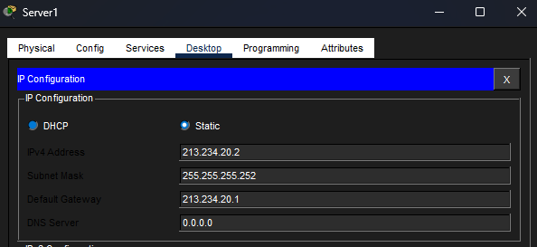
```
IP Address: 213.234.20.2
Subnet Mask: 255.255.255.252
Default Gateway: 213.234.20.1
```

---

## 5. Настройка NAT на Router0

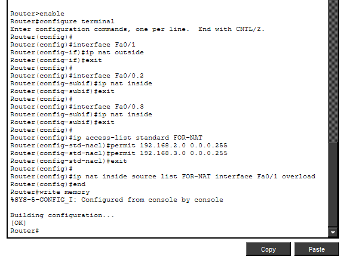
```
enable
configure terminal

interface Fa0/1
ip nat outside
exit

interface Fa0/0.2
ip nat inside
exit

interface Fa0/0.3
ip nat inside
exit

ip access-list standard FOR-NAT
permit 192.168.2.0 0.0.0.255
permit 192.168.3.0 0.0.0.255
exit

ip nat inside source list FOR-NAT interface Fa0/1 overload
end
write memory
```

---

## 6. Проверка трансляций NAT

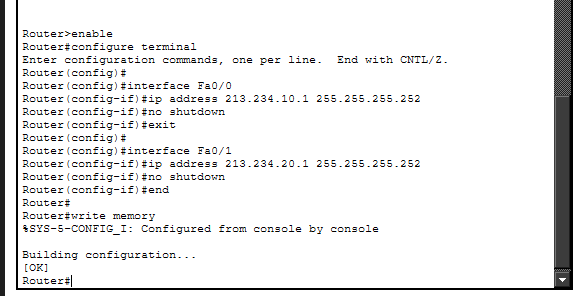
```
show ip nat translations
```

В таблице видны пары «внутренний локальный → внешний глобальный».

---

## 7. Настройка статического NAT (проброс порта 80)

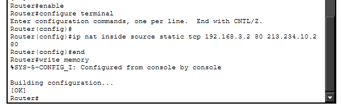
```
enable
configure terminal

ip nat inside source static tcp 192.168.3.2 80 213.234.10.2 80
end
write memory
```

---

## 📋 Итоговая таблица IP-адресов

| Устройство | Интерфейс | IP-адрес | Маска |
|---|---|---|---|
| Router0 | Fa0/0.2 | 192.168.2.1 | 255.255.255.0 |
| Router0 | Fa0/0.3 | 192.168.3.1 | 255.255.255.0 |
| Router0 | Fa0/1 | 213.234.10.2 | 255.255.255.252 |
| Router1 | Fa0/0 | 213.234.10.1 | 255.255.255.252 |
| Router1 | Fa0/1 | 213.234.20.1 | 255.255.255.252 |
| PC0 | Fa0 | 192.168.2.2 | 255.255.255.0 |
| PC1 | Fa0 | 192.168.2.3 | 255.255.255.0 |
| PC2 | Fa0 | 192.168.2.4 | 255.255.255.0 |
| Server0 | Fa0 | 192.168.3.2 | 255.255.255.0 |
| Server1 | Fa0 | 213.234.20.2 | 255.255.255.252 |

---

## 🗺 VLAN

| VLAN | Имя | Порты | Назначение |
|---|---|---|---|
| 2 | users | Fa0/1-3 | Компьютеры |
| 3 | server | Fa0/4 | Локальный сервер |
| Trunk | — | Fa0/5 | Связь с Router0 |