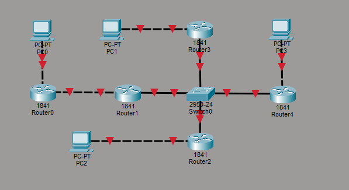
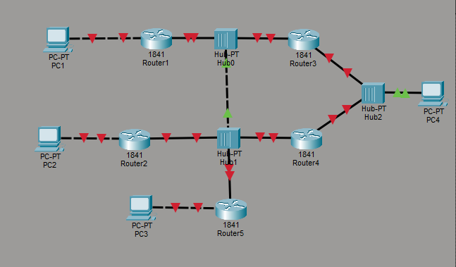
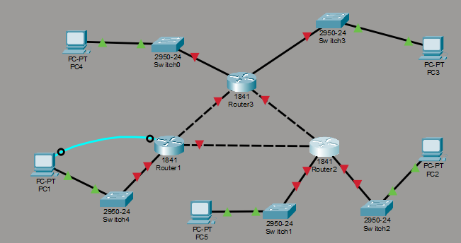

**Описание схем:**

*   **Схема 1:** Сеть с коммутатором и маршрутизаторами (Router0–4), соединенными через общий свитч.

    

*   **Схема 2:** Сеть на основе концентраторов (Hub0–2) и маршрутизаторов (Router1–5).

    

*   **Схема 3:** Смешанная сеть, где коммутаторы (Switch0–4) объединяют ПК, а роутеры (Router1–3) связывают сегменты.

    