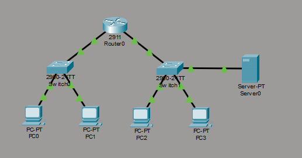
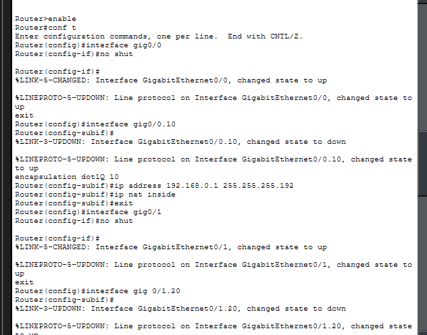
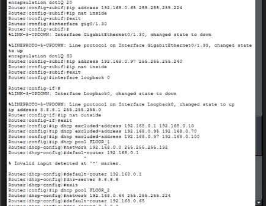
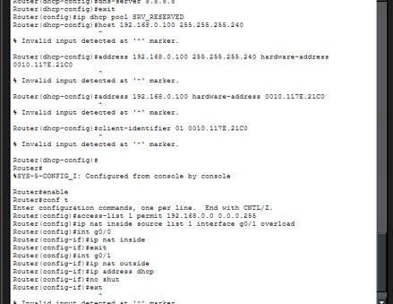
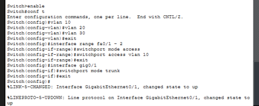
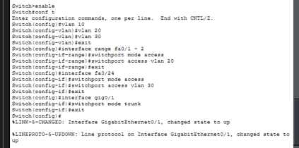

# Билет 13. Корпоративная сеть

| | |
| :--- | :--- |
| 📝 **ФИО** | Гаврилов Владислав |
| 🎓 **Группа** | РПО/1 |
| 🛠️ **Дисциплина** | Компьютерные сети |

## Структура

### Схема сети

### Настройка роутера:

### Настройка switch-0 / switch-1:

### Настройка switch-0 (1 этаж)

### Настройка switch-1 (2 этаж)

---

## Отчет

### Цель
Настроить сеть из двух этажей с сервером. Разделить устройства на логические группы (VLAN), настроить автоматическую выдачу IP-адресов (DHCP), зарезервировать адрес для сервера и обеспечить выход во внешнюю сеть с помощью трансляции адресов (NAT).

### Оборудование (по схеме)
*   1 Роутер (2911)
*   2 Коммутатора (2960)
*   4 ПК (PC0, PC1 на 1 этаже; PC2, PC3 на 2 этаже)
*   1 Сервер (Server0)

---

### 1. Настройка коммутаторов (Скриншоты 4 и 5)
На коммутаторах мы настроили виртуальные локальные сети (VLAN) и распределили порты.

*   **Switch0 (1 этаж):** Созданы VLAN 10, 20, 30. Порты Fa0/1 и Fa0/2 отданы под VLAN 10 (первый этаж). Порт Gig0/1 переведен в режим Trunk (магистральный канал), чтобы передавать трафик всех VLAN на роутер.
*   **Switch1 (2 этаж):** Созданы те же VLAN. Порты Fa0/1 и Fa0/2 отданы под VLAN 20 (второй этаж). Порт Fa0/24 выделен под VLAN 30 для подключения сервера. Порт Gig0/1 также переведен в режим Trunk для связи с роутером.

---

### 2. Настройка Роутера: Маршрутизация и DHCP (Скриншоты 1 и 2)
Роутер выступает шлюзом для всех сетей.

*   **Подынтерфейсы:** Так как провода от коммутаторов приходят в разные порты роутера, мы настроили сабинтерфейсы (`g0/0.10` для первого этажа, `g0/1.20` и `g0/1.30` для второго и сервера). Им были присвоены IP-адреса шлюзов.
*   **Раздача IP (DHCP):** Мы настроили два пула (`FLOOR_1` и `FLOOR_2`).
    *   *Исправление ошибки:* При вводе команды `default-router` мы убрали маску подсети, оставив только IP-адрес шлюза, так как Packet Tracer не принимает маску в этой команде.
*   **Резервирование для сервера:** Создан пул `SRV_RESERVED`.
    *   *Исправление ошибки:* Чтобы обойти баг программы, мы ввели MAC-адрес сервера командой `hardware-address 0010.117E.21C0`, а затем закрепили за ним IP `192.168.0.100` командой `host`.

---

### 3. Настройка NAT/PAT (Скриншот 2)
Для выхода в интернет настроена трансляция адресов.

*   Создан Access-list 1, разрешающий сеть `192.168.0.0/24`.
*   Включен PAT (перегрузка) командой `ip nat inside source list 1 interface loopback 0 overload`.
*   *Исправление ошибки:* Так как в схеме нет реального подключения к провайдеру, мы создали виртуальный интерфейс `Loopback 0` с IP `8.8.8.1` и назначили его внешним (`ip nat outside`). Все внутренние интерфейсы (подынтерфейсы VLAN) помечены как `ip nat inside`.

---

### 4. Проверка работы (Вывод)

*   **DHCP:** На компьютерах выставлено получение адреса автоматически. Они успешно получили IP из своих подсетей.
*   **Маршрутизация:** Пинг с первого этажа на второй проходит (роутер перекидывает пакеты между VLAN).
*   **NAT:** Проверка пингом внешнего адреса `8.8.8.1` проходит. На роутере командой `show ip nat translations` видно, как внутренние адреса заменяются на внешний.
*   **Резервирование:** Сервер получил свой закрепленный IP-адрес `192.168.0.100`.

---

### Полная схема инкапсуляции (от ПК до внешнего сервера)
*Простыми словами, как пакет идет от компьютера в интернет:*

1.  **ПК (Уровень приложений):** Пользователь открывает сайт. Формируется HTTP-запрос.
2.  **ПК (Транспортный уровень):** Данные упаковываются в TCP-сегмент (указывается порт назначения 80).
3.  **ПК (Сетевой уровень):** Добавляется IP-заголовок. ПК видит, что сайт находится не в его сети, и решает отправить пакет на шлюз (роутер).
4.  **ПК (Канальный уровень):** ПК по протоколу **ARP** узнает MAC-адрес роутера. Пакет упаковывается в Ethernet-кадр.
5.  **Коммутатор:** Свитч смотрит MAC-таблицу и передает кадр по транковому порту на роутер.
6.  **Роутер (NAT):** Роутер понимает, что пакет идет наружу. Он делает трансляцию: меняет внутренний IP компьютера на свой внешний IP (`8.8.8.1`) и меняет порт. Запись сохраняется в NAT-таблице.
7.  **Интернет:** Пакет уходит во внешнюю сеть, где маршрутизаторы передают его до нужного сервера, меняя только канальные заголовки (MAC-адреса).
8.  **Обратный путь:** Сервер отвечает. Ответ приходит на роутер. Роутер смотрит в NAT-таблицу, видит, какому ПК предназначен ответ, делает обратную замену IP и отдает пакет через коммутатор нужному компьютеру.