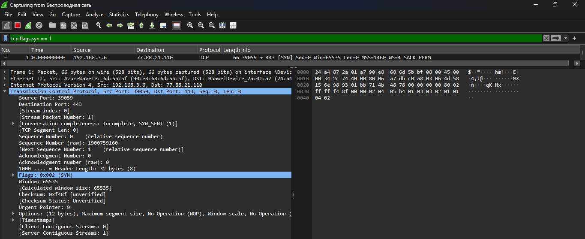
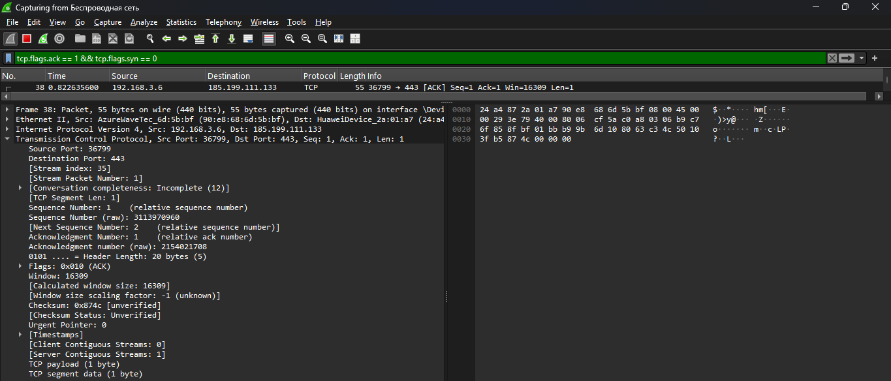
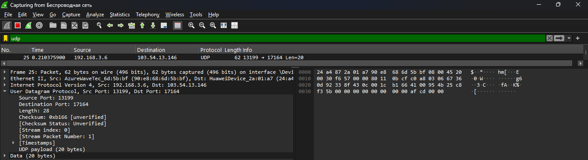

# Анализ трафика в Wireshark

**ФИО:** Гаврилов Владислав Михайлович  
**Группа:** РПО/1
**Дата:** 21.10.2026

## Что сделано
С помощью программы Wireshark был перехвачен и проанализирован сетевой трафик. В ходе работы были найдены пакеты по трем заданным критериям.

## Скриншоты

### 1. TCP-пакет с флагом SYN (запрос на установку соединения)

### 2. TCP-пакет с флагом ACK (подтверждение получения данных)

### 3. UDP-пакет (передача данных без установки соединения)
